# Install walkthrough: USB stick to first boot to demo graphic

One recorded run of the whole flow: a debug build booted from a USB stick,
installed onto an empty NVMe disk, rebooted into the installed system, and
showing the demo OGraf lower third (`[player] demo = true` set in
`config.toml` on the stick's SIGNCFG partition before booting).

> **These timings come from QEMU TCG emulation** (x86_64 emulated on an
> M-series Mac, inside the OrbStack `signage-build` machine), **not from real
> M715q hardware.** Emulation makes everything CPU-bound several times slower,
> especially the 170 MB UKI load, Firefox start-up and the animations. Treat
> the numbers as an upper bound and the order of events as the useful part.

Setup: image `0.1.0.2611211835` (debug profile), `scripts/qemu-test.sh
--headless` (q35, OVMF, 4 vCPUs, 4 GB RAM, the image as a USB stick on xHCI,
an empty 32 GB NVMe disk, user-mode networking with DHCP). A recorder took a
`screendump` from the QEMU monitor every second and timestamped the serial
console. t = 0 is QEMU start (power-on). The full serial log is in
[`walkthrough/serial.log`](walkthrough/serial.log).

## Timeline

| t (s) | Stage |
|------:|-------|
| 0.0 | Power on |
| 7.7 | OVMF (TianoCore) starts the USB stick's boot entry, `Boot0001` |
| 7.9–24.6 | systemd-boot (timeout 0, so no menu) loads the UKI from the stick and starts the kernel |
| 24.6 | initrd starts |
| 31.0 | dm-verity `/usr` found by `usrhash=` (initrd-root-device.target) |
| 36.8 | Switch to the real root: the stick's own root partition |
| 50.1 | `signage-config` finishes: installer mode, config from the stick |
| 50.2 | `signage-install` takes over tty1 |
| 52.9 | Installer shows the stick, the target disk and the 15 s countdown |
| 68.8 | Countdown done; systemd-repart lays out the NVMe disk |
| 68.8–115 | ESP copied (9.0 s), usr A copied (1.1 GB, 27.6 s), verity A (0.3 s), B slots left empty, root formatted and populated |
| ~116 | Firmware boot entry "Signage" added, set first and BootNext |
| 117.2 | "Installed to /dev/nvme0n1. Rebooting into it in 10 s." |
| 129.2 | Reboot |
| 132.8 | OVMF starts `Boot0008 "Signage"` from the NVMe ESP |
| 132.8–162.1 | systemd-boot loads the UKI from the NVMe disk |
| 162.1 | initrd starts (installed system, first boot) |
| 174.3 | Switch to the NVMe root |
| 184.9 | `signage-web` (local server for the host page) started |
| 186.4 | `signage-config` finishes: normal mode, `/var/lib/signage/config.toml` |
| 187.8 | NetworkManager up; `signage-wired` is activated with DHCP within half a second |
| 188.0 | `signage-player` (cage + Firefox) started |
| 197.2 | cage is on tty1 (black screen, cursor) |
| 218.2 | Firefox window appears |
| 236.1 | Firefox's normal window chrome shows briefly before kiosk mode takes over |
| 242.4 | Host page drawn, with the status overlay in the top-right corner |
| ~245 | Demo lower third animates in for the first time |
| 255.0 | Overlay shows "NTP synced" |
| 258 → 264 | One loop: animates in, holds 6 s, animates out, 2 s gap; repeats about every 10.5 s |

From power-on, the install finished in about **2 minutes** and the demo was
on screen in about **4 minutes**. Under emulation, most of that is the two UKI
loads (17 s and 29 s), the block copy of `/usr` and Firefox start-up (about
55 s from `signage-player` to the first frame of the page).

### systemd-analyze (installed system, first boot)

```
Startup finished in 23.709s (kernel) + 12.459s (initrd) + 19.124s (userspace) = 55.294s
multi-user.target reached after 19.106s in userspace.

multi-user.target @19.106s
└─chrony-wait.service @12.693s +6.406s
  └─chrony.service @12.278s +364ms
    └─signage-config.service @10.657s +1.581s
      └─systemd-udev-settle.service @7.707s +2.920s
        └─systemd-udev-trigger.service @6.328s +1.365s
          └─systemd-udevd-kernel.socket @5.846s
            └─system.slice
              └─-.slice
```

`chrony-wait` holds multi-user.target until the clock is synced. The kiosk
doesn't wait for it: `signage-player` started 13.8 s into userspace.

## Screenshots

**1. Firmware boots the stick.** systemd-boot has a zero timeout, so no menu
is shown; the next thing on screen is the installer.

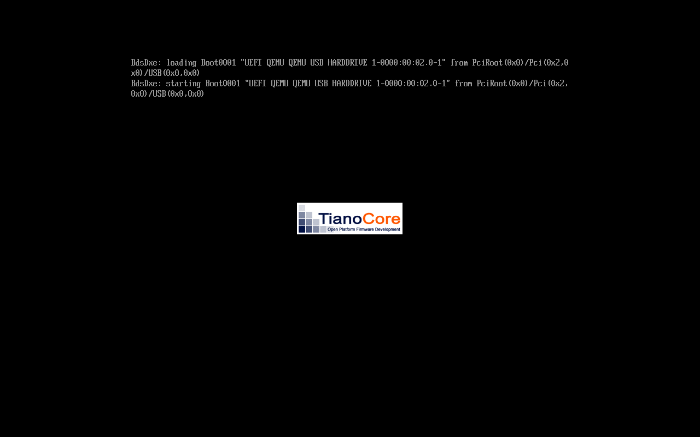

**2. Installer countdown on tty1.** It shows the stick, the chosen target
disk and a 15 s countdown; any key cancels.

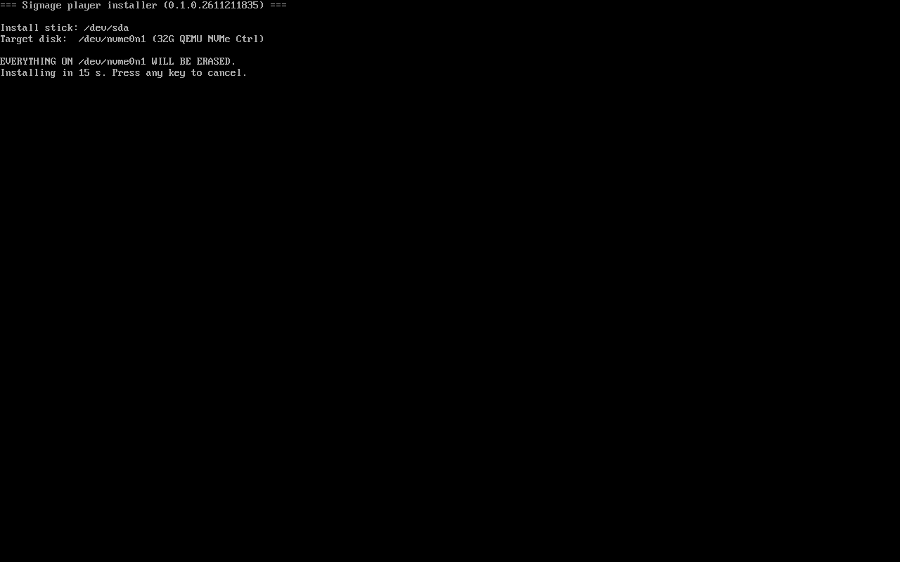

**3. systemd-repart writing the NVMe disk.** ESP, usr A + verity A copied
block by block with the stick's UUIDs, empty usr B / verity B (`_empty`), and
a root partition filling the rest.

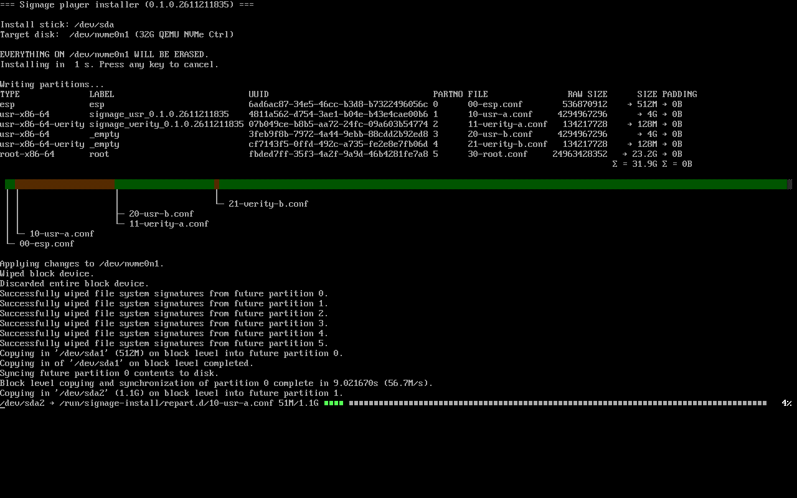

**4. Install done.** The firmware boot entry is added and the machine
reboots after 10 s.

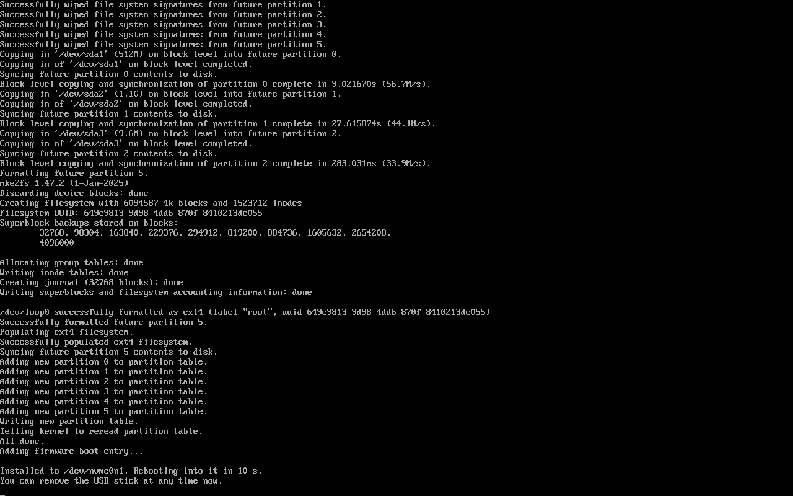

**5. Firmware boots the installed disk** through the new "Signage" entry
(BootNext), even though the stick is still attached.

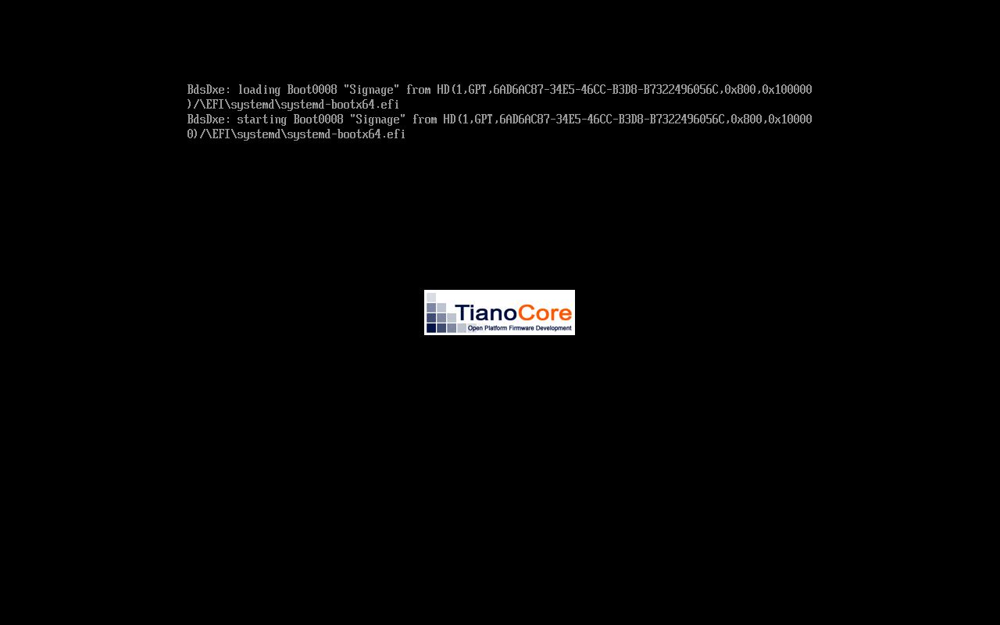

**6. First boot of the installed system: serial console.** tty1 stays blank
during boot in the debug build, because the last `console=` on the kernel
command line is `ttyS0`, so systemd's status output goes there. This is the
serial log from the initrd to the autologin prompt, with the generic lines
trimmed.

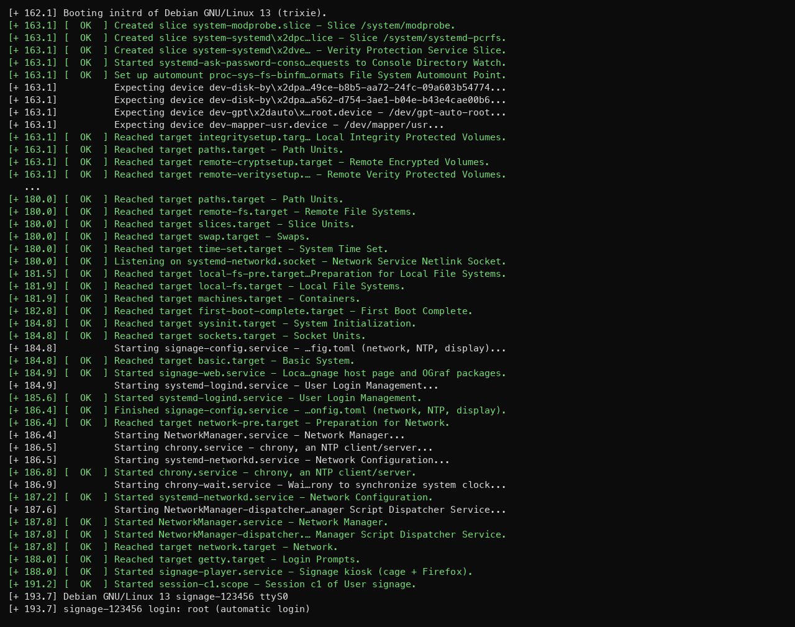

**7. Firefox starting.** For a few seconds Firefox shows its normal window
chrome before kiosk mode applies (see "Seen in this run").

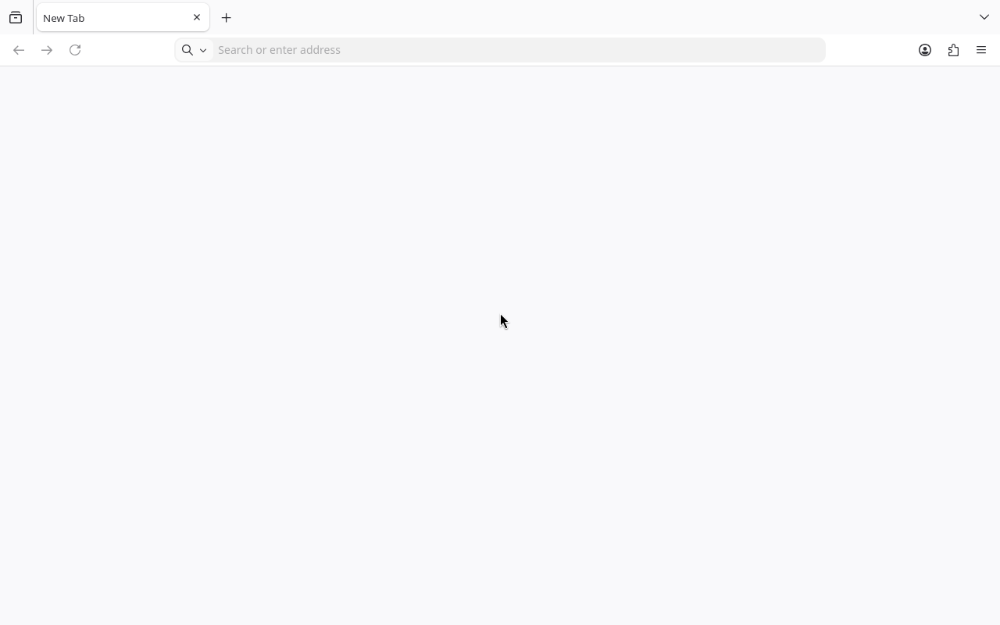

**8. Host page with the status overlay**: hostname, image version, address,
clock and NTP state, config source.

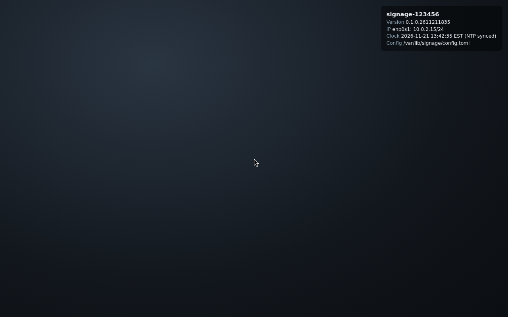

**9–11. The demo lower third**: animating in (the title hasn't faded in
yet), held, and animating out.

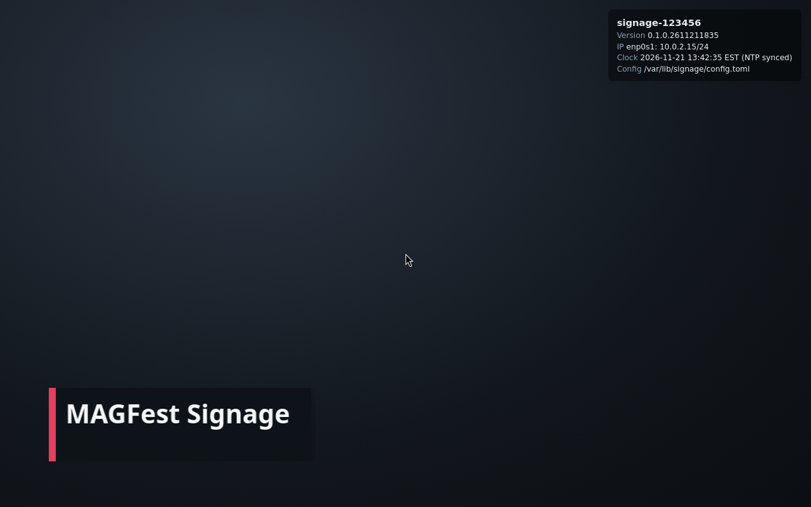
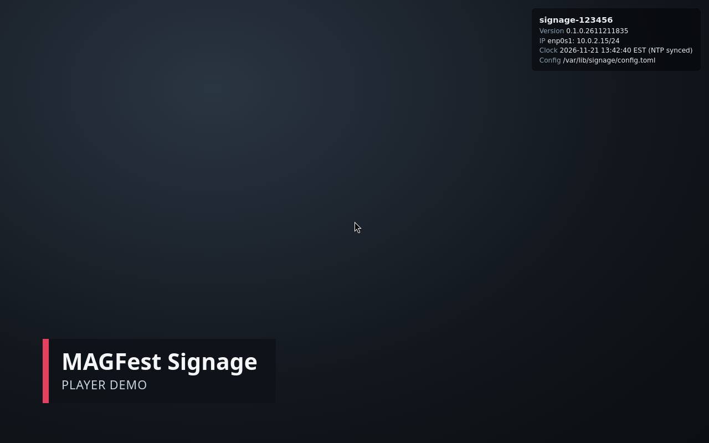
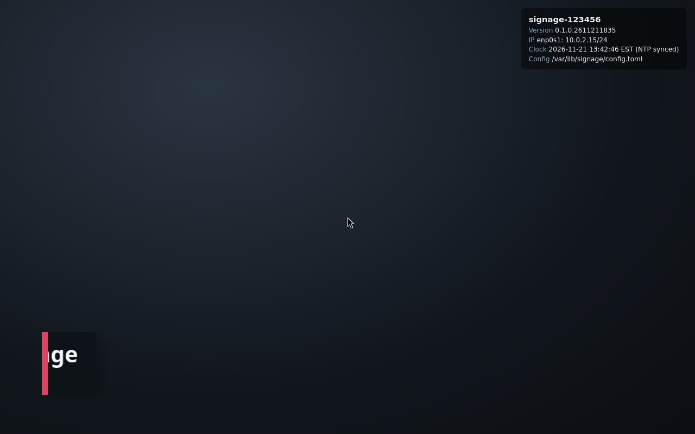

## Seen in this run

- **Firefox window chrome before kiosk mode** (screenshot 7): the tab strip
  and toolbar show for a few seconds on first start. Worth checking on real
  hardware; if it shows there too, a dark `about:blank` start page or
  starting cage's output black until the page loads would hide it.
- **Mouse cursor in the middle of the screen**: cage draws a cursor even
  with no pointer device; the host page's `cursor: none` only applies once
  the pointer moves over it.
- **UKI size**: the UKI is about 170 MB, mostly a 165 MB initrd. Loading it
  takes 17 s from the emulated USB stick and 29 s from the emulated NVMe. A
  slimmer initrd would help boot time on real hardware too.
- **Animation speed**: the lower third's in and out animations (900 ms and
  600 ms by design) take 1–2 s under emulation.

## Reproducing

```bash
scripts/build.sh --profile=debug
# set demo = true under [player] in config.toml on the image's SIGNCFG partition
scripts/qemu-test.sh            # serial console on stdio, screen on VNC :1
```
