# Secure Boot test run (QEMU)

One run of `scripts/qemu-test.sh --secure-boot --headless` on 2026-11-21:
image `0.1.0.2611211946` (debug profile, signed with a dev key, so the
stick also carries `build-signing.cer`), OVMF `OVMF_CODE_4M.secboot.fd` with
`OVMF_VARS_4M.ms.fd` (Secure Boot on, Microsoft KEK/db, no MOKs), an empty
NVMe disk and `[player] demo = true`. Keys were sent with the QEMU
monitor's `sendkey`. As with the [install walkthrough](install-walkthrough.md),
this is TCG emulation, so the timings are slow.

## Result

| Check | Result |
|---|---|
| Stick boots with Secure Boot on and no MOK | shim refuses systemd-boot (0x1A Security Violation) and starts MokManager |
| Enroll key from disk (ESP → `signage-mok/build-signing.cer`) | enrolled; the stick boots into the installer |
| Installer sees Secure Boot | `Secure Boot: SecureBoot enabled` |
| Installer skips keys already trusted | `build-signing.cer: already trusted` |
| Installer queues the rest | `magfest-signage-mok-2026.cer magfest-signage-mok-backup.cer` |
| Firmware boot entry | `Boot0007* Signage … \EFI\BOOT\BOOTX64.EFI` (shim) |
| First boot from NVMe | MokManager shows the request; Enroll MOK → 2 keys → Yes → password `signage` → Reboot |
| `mokutil --sb-state` on the installed system | `SecureBoot enabled` |
| `mokutil --list-enrolled` | Debian Secure Boot CA (shim's built-in), dev key, MAGFest Signage MOK 2026, MAGFest Signage MOK backup |
| `mokutil --list-new` | empty |
| `/sys/kernel/security/lockdown` | `none [integrity] confidentiality` |
| `bootctl status` | Secure Boot: enabled (user); systemd-boot 257.13 and systemd-stub 257.13 running |
| Demo graphic | showing, NTP synced |
| `sbverify` on the build | UKI, systemd-boot and `grubx64.EFI` verify against the signing cert; `BOOTX64.EFI` is signed by Microsoft |

Not covered by QEMU: the BIOS report needs Lenovo's WMI interface. I ran the
installer's `bios_report` against a fake `thinklmi` sysfs tree on the
running VM: it wrote `bios-unknown.txt` (QEMU has no serial number) to
SIGNCFG with the DMI lines, the `authentication` entries and the attribute
list, and SIGNCFG was left mounted read-only elsewhere.

Seen along the way:

- shim gives MokManager **one** chance per failed boot. Miss the 10 s "Press
  any key" and the next failure goes straight to the firmware's next boot
  option (PXE here). Power-cycle to try again.
- If nobody answers MokManager on the first boot after install, the queued
  request is dropped and the system boots normally (it was already trusted
  through the stick enrollment). Only the backup certificate would be
  missing then.

## Screens

**Stick, first boot on a machine without our key**

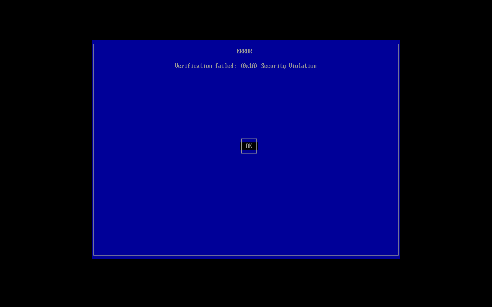
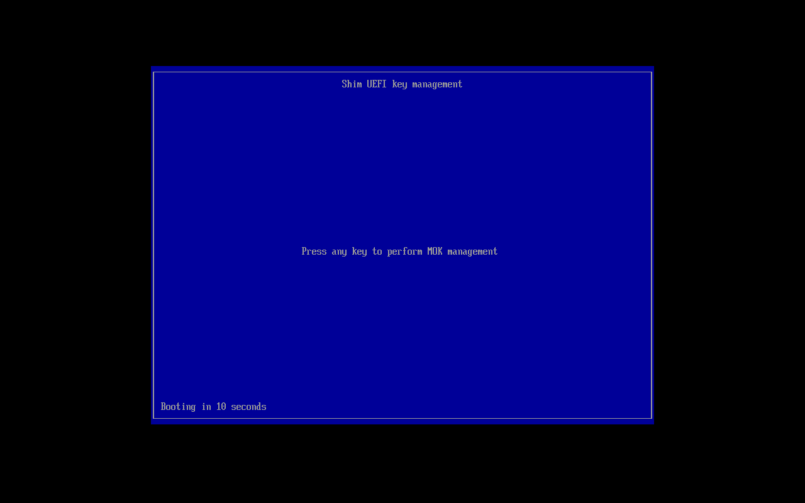
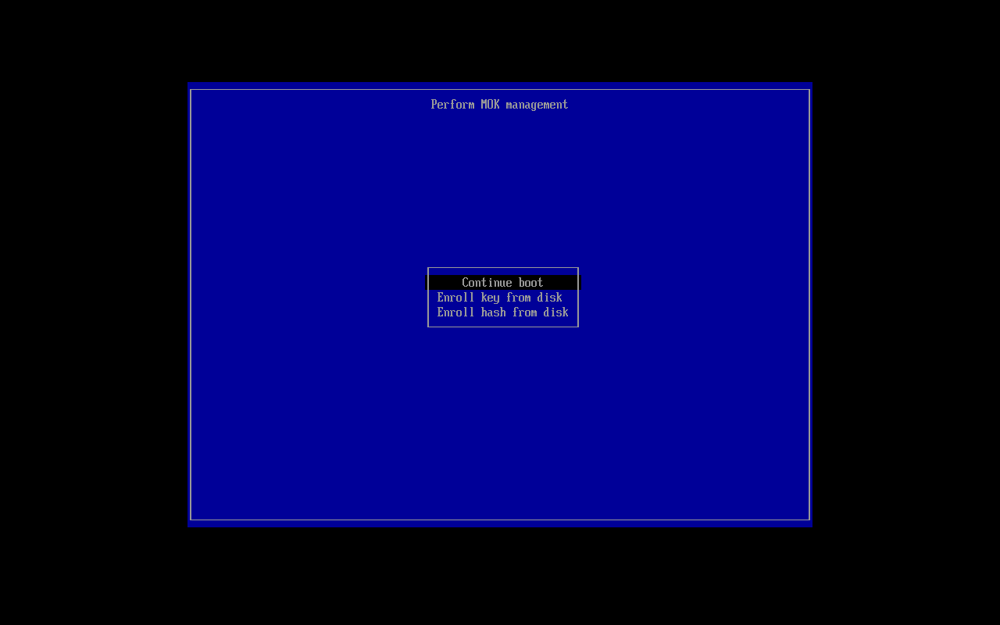
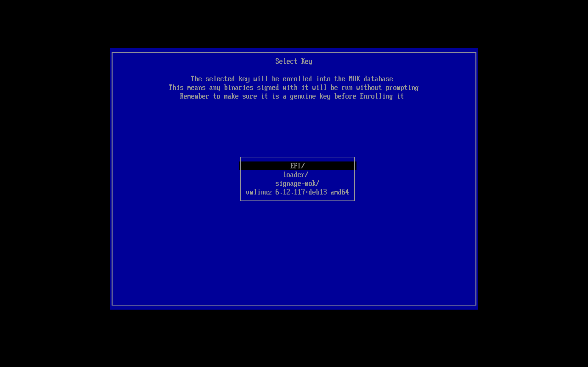
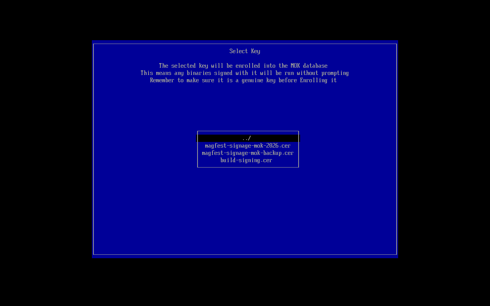
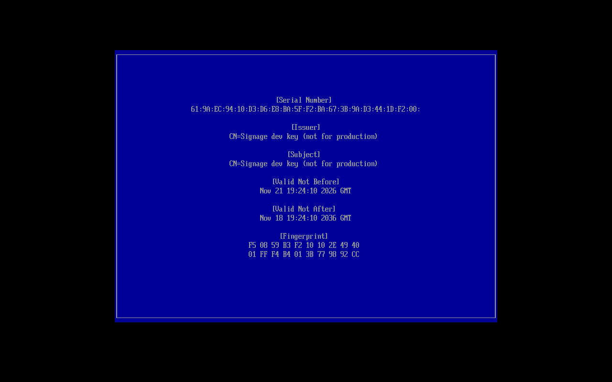
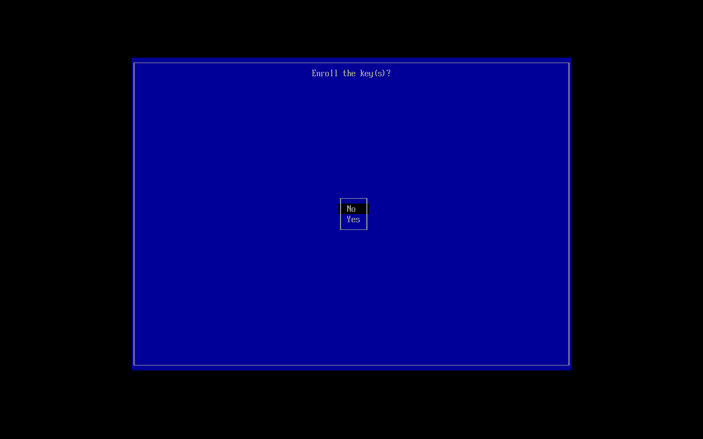

**Installer**

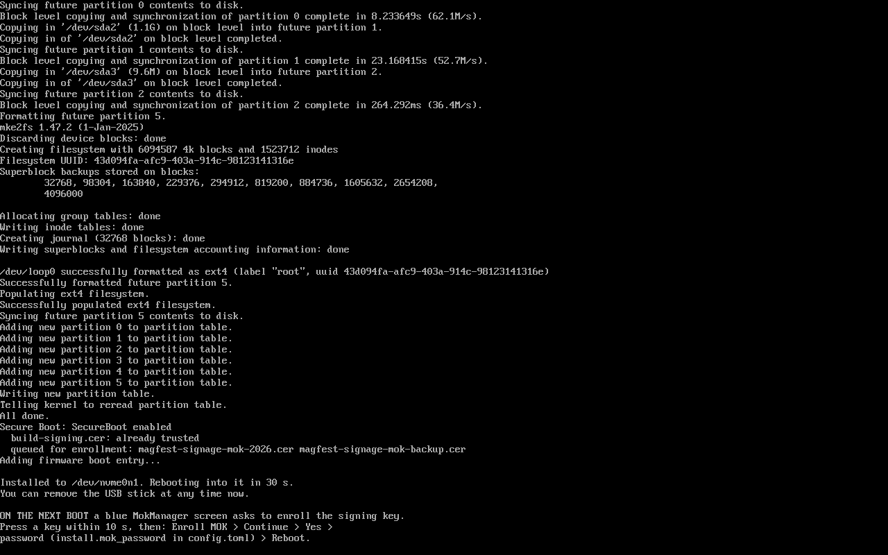

**First boot from the disk: confirm the queued keys**

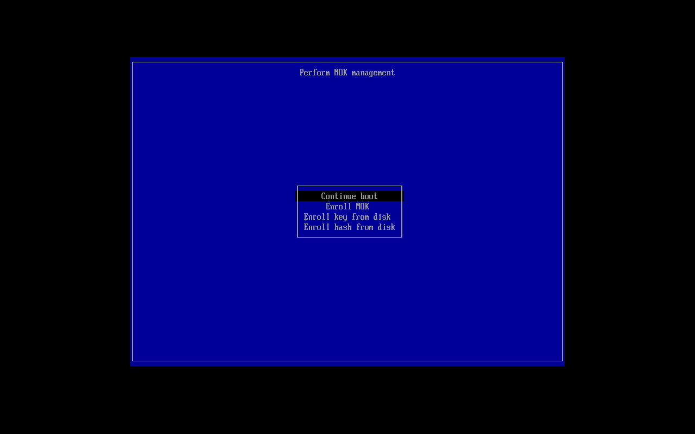
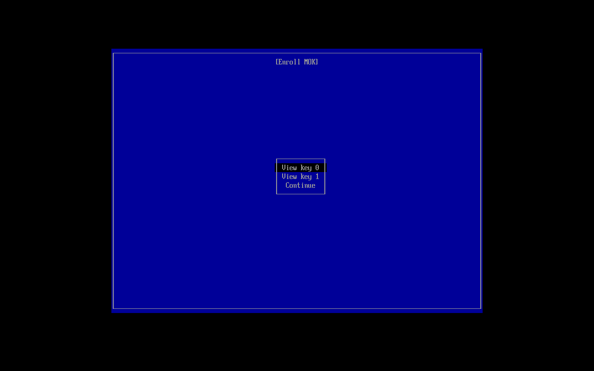
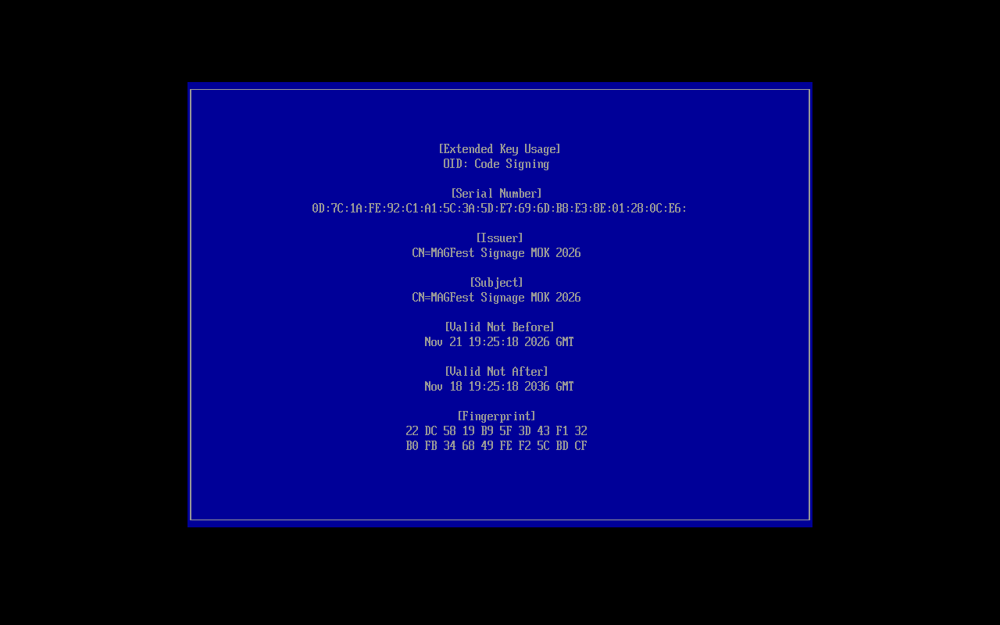
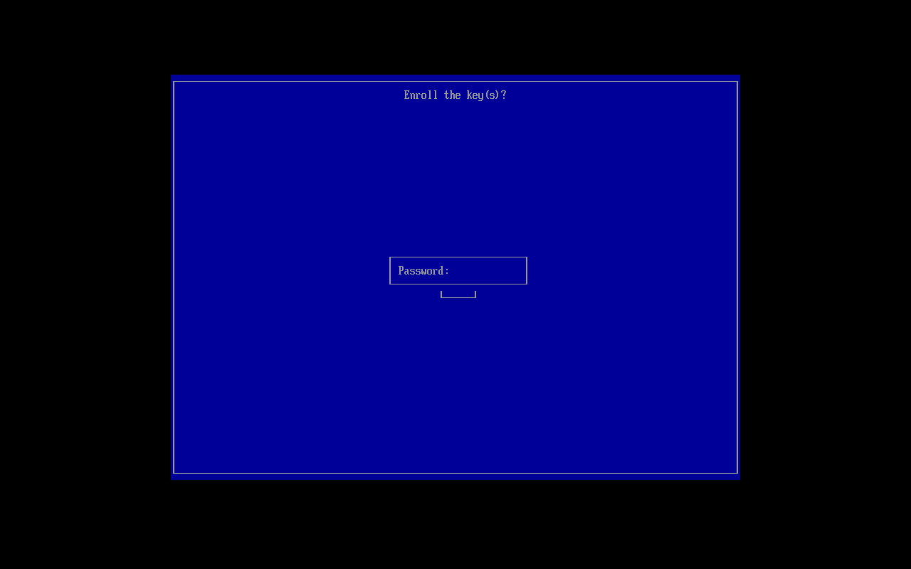

**Signed boot, demo running**

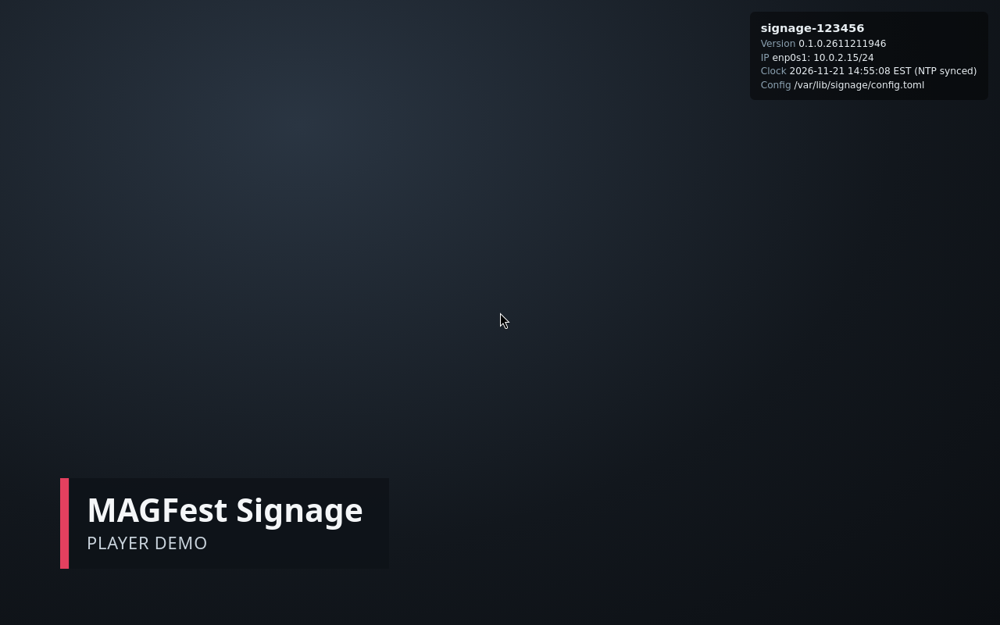
